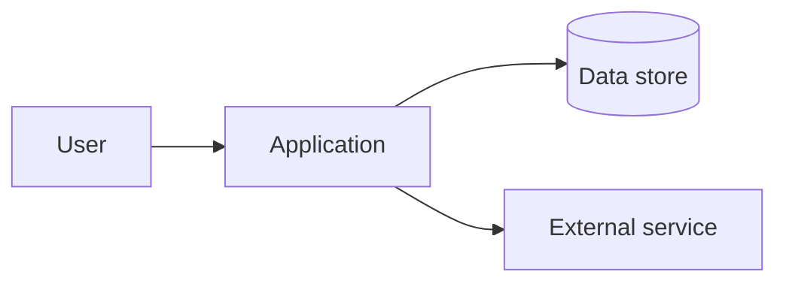

# Architecture

> Purpose: explain the system shape and its constraints, not every implementation detail. ChatGPT should use it when comparing technical options. Codex should follow its boundaries and interfaces, then update it when an accepted change makes the diagram or contracts inaccurate.

## Context

[Describe where this system sits, who or what calls it, and the external systems it relies on.]

## Quality attributes

Rank the attributes that drive design tradeoffs.

1. [For example: correctness]
2. [For example: maintainability]
3. [For example: latency]

## System overview

Replace this diagram with the real high-level design.

## Components

| Component | Responsibility | Owns | Must not own |
| --- | --- | --- | --- |
| [Component] | [Single clear responsibility] | [Data or behavior] | [Boundary] |

## Data model

[Document important entities, ownership, retention, and lifecycle. Link to schemas where appropriate.]

## Interfaces and contracts

| Interface | Producer | Consumer | Contract and compatibility policy |
| --- | --- | --- | --- |
| [API/event/function] | [Owner] | [Caller] | [Link or summary] |

## Data and control flows

[Describe important request, event, background-job, and failure flows.]

## Security and privacy

- Trust boundaries: [Describe]
- Authentication and authorization: [Describe]
- Sensitive data: [Classification, storage, and redaction rules]
- Threats and mitigations: [Link to threat model if present]

## Deployment and operations

- Environments: [Local, test, staging, production]
- Configuration: [How configuration is supplied and validated]
- Observability: [Logs, metrics, traces, alerts]
- Recovery: [Backup, rollback, and disaster-recovery approach]

## Known constraints and technical debt

- [Constraint or debt item, impact, and intended resolution]

## Related decisions

- [Link to entries in `decision-log.md`]
